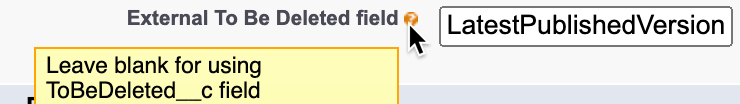
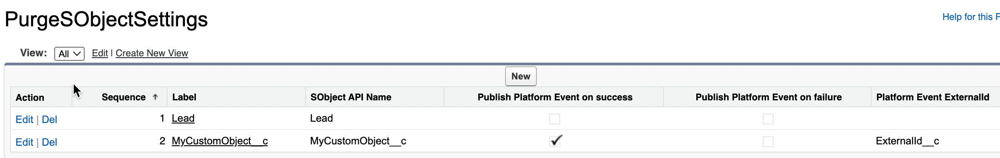
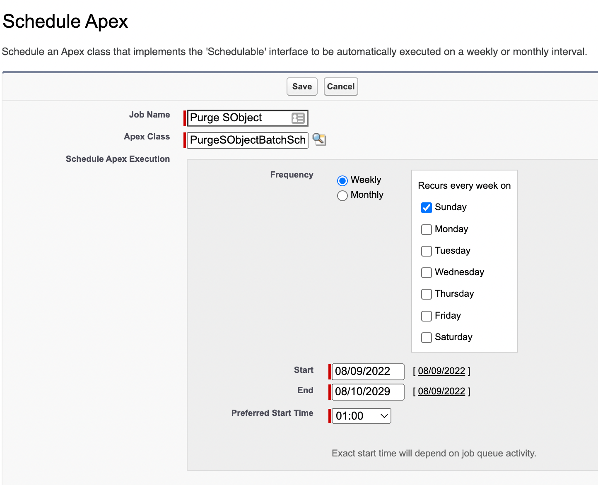
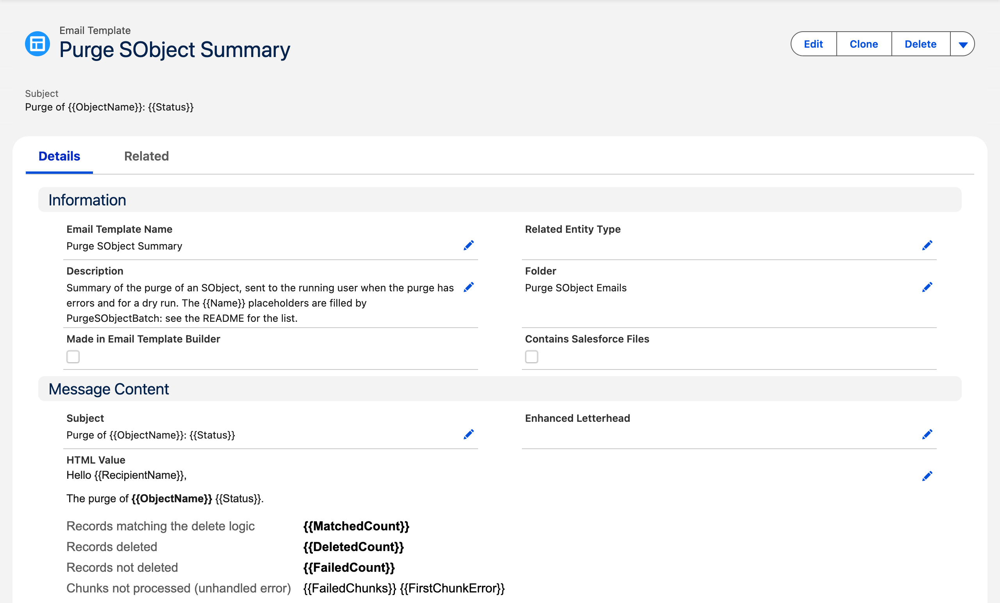
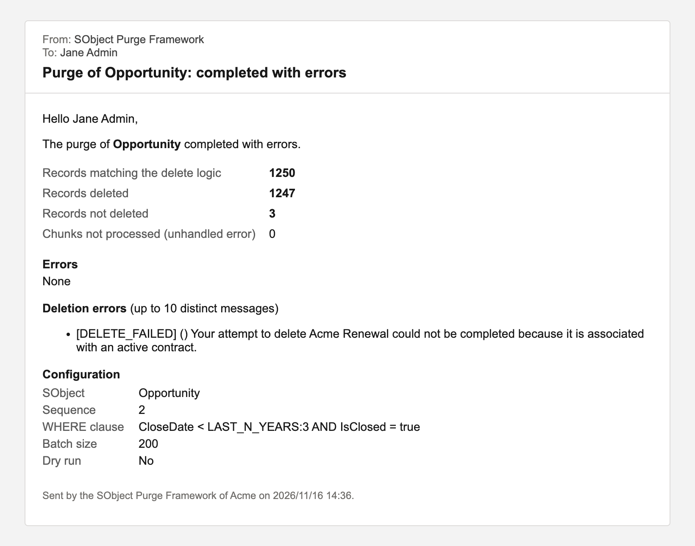
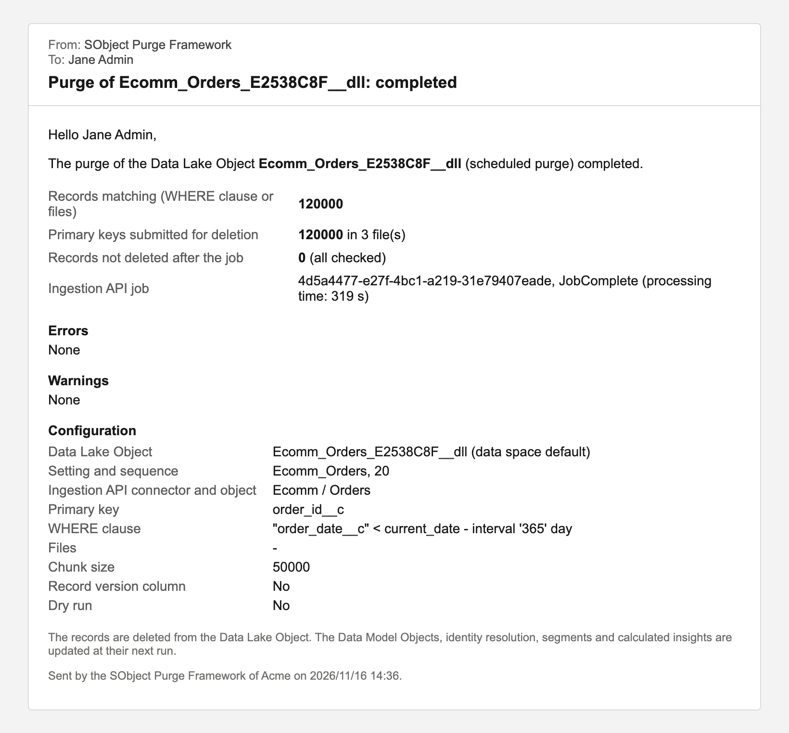

# SObject Purge Framework

This framework deletes records on a schedule. Admins configure which SObjects to purge, which records to delete, and in which order, with custom metadata records instead of code.

An optional module, in the `data360` folder, also purges the records of Data 360 Data Lake Objects with the Ingestion API. See [Data 360 module](#data-360-module-optional). The framework works without it.

## Disclaimer

SObject Purge Framework is not an official Salesforce product. It has not been officially tested or documented by Salesforce.

## How it works

1. The scheduled job `PurgeSObjectBatchSchedulable` starts the `PurgeSObjectBatch` batch for the setting with the lowest `Sequence__c`. If a purge is still running, it skips this run.
2. The batch queries the records to delete for that SObject, and deletes them in chunks of `BatchSize__c` records (200 by default). A record that can't be deleted doesn't stop the others.
3. When the batch finishes, it starts a new batch for the next sequence, until the last setting.
4. If the query of a setting fails (unknown object or field, invalid WHERE clause), that SObject is skipped and the purge continues with the next sequence.
5. If there were errors, the user who runs the purge receives a summary email for that SObject.
6. A setting whose object can't be deleted by Apex, such as a Data 360 Data Lake Object, is purged by the handler of an optional module when it is deployed. The module continues the chain with the next sequence when it is done.

## Configure the purge

The configuration has two parts:

- The delete logic: which records of an SObject must be deleted.
- One `PurgeSObjectSetting__mdt` custom metadata record per SObject to purge.

### Delete logic

Choose one of these options for each SObject:

| Option | How to configure it | Used when |
| --- | --- | --- |
| `ToBeDeleted__c` field (default) | Create a Boolean formula field named `ToBeDeleted__c` on the SObject. If the criteria are too complex for a formula, create a checkbox field and set it with a flow or an Apex trigger. | `WhereClauseToBeDeleted__c` and `ExternalToBeDeletedField__c` are empty |
| Custom WHERE clause | Enter a SOQL WHERE clause, without the `WHERE` keyword, in `WhereClauseToBeDeleted__c`. For example: `CreatedDate < LAST_N_DAYS:365`. | `WhereClauseToBeDeleted__c` is set |
| Field on a related object | Enter a Boolean field of a related object, through its relationship, in `ExternalToBeDeletedField__c`. For example: `LatestPublishedVersion.ToBeDeleted__c` to delete `ContentDocument` records based on a field of their `ContentVersion`. | `ExternalToBeDeletedField__c` is set |

The `PreventMultipleDeletionLogical` validation rule prevents setting both `WhereClauseToBeDeleted__c` and `ExternalToBeDeletedField__c`.

#### Objects that can't have custom fields

Some SObjects, such as `ContentDocument`, can't have custom fields. Use a field of a related object instead. For example, create `ToBeDeleted__c` on `ContentVersion`, and enter `LatestPublishedVersion.ToBeDeleted__c` in the `ExternalToBeDeletedField__c` of the `ContentDocument` setting.



#### Performance on large objects

The batch selects the records to delete with one query. On a large object, a query that isn't [selective](https://help.salesforce.com/s/articleView?id=000385218&type=1) scans the whole table and can time out.

- Formula fields aren't indexed. Salesforce Support can add a custom index to some deterministic formula fields, but never to cross-object formulas such as `LatestPublishedVersion.ToBeDeleted__c`. A `ToBeDeleted__c` formula or an `ExternalToBeDeletedField__c` works well on small objects, but can be slow on large ones.
- On large objects, prefer a `WhereClauseToBeDeleted__c` on indexed fields, such as `CreatedDate < LAST_N_DAYS:365` or `LastModifiedDate < LAST_N_YEARS:2`. You can check a query with the Query Plan tool of the Developer Console.

### Custom metadata records

Create one `PurgeSObjectSetting__mdt` record per SObject to purge (Setup > Custom Metadata Types > PurgeSObjectSetting > Manage Records).

| Field | Required | Description |
| --- | --- | --- |
| `SObjectApiName__c` | Yes | API name of the SObject to purge. Each SObject can have only one setting. |
| `Sequence__c` | Yes | Order in which the SObjects are purged, from the lowest to the highest. Each setting needs a different number, from -99 to 99. Purge child objects before their parent, for example `OpportunityLineItem` before `Opportunity`. |
| `WhereClauseToBeDeleted__c` | No | SOQL WHERE clause that selects the records to delete. See [Delete logic](#delete-logic). |
| `ExternalToBeDeletedField__c` | No | Boolean field of a related object that selects the records to delete. See [Delete logic](#delete-logic). |
| `BatchSize__c` | No | Number of records deleted per chunk, from 1 to 2000. 200 when empty. Use a lower value for objects with cascade deletes or heavy triggers. |
| `DryRun__c` | No | Count the records that match the delete logic, without deleting them. See [Dry run](#dry-run). |
| `PublishPlatformEventOk__c` | No | Publish a platform event for the deleted records. |
| `PublishPlatformEventKo__c` | No | Publish a platform event for the records that couldn't be deleted, and for a setting whose query fails. |
| `PlatformEventExternalId__c` | No | API name of a field of the purged SObject, sent as `ExternalId__c` in the platform events. |
| `PublishPlatformEventPerChunk__c` | No | Publish one platform event per chunk of records instead of one per record. See [Platform events](#platform-events). |



The repository contains a sample setting, `PurgeSObjectSetting.Lead`, with sequence 1. It deletes the leads whose last name is `TO-BE-DELETED`, and the test classes use it. Before deploying it, check that:

- No other setting of your org uses sequence 1, otherwise the deployment fails.
- Deleting leads with that last name is acceptable in your org.

## Run the purge

### Schedule the purge

In Setup, go to Apex Classes, click **Schedule Apex**, and select the `PurgeSObjectBatchSchedulable` class.



Or schedule it with Anonymous Apex:

```apex
//run the purge every day at 1 AM
System.schedule('Purge SObjects', '0 0 1 * * ?', new PurgeSObjectBatchSchedulable());
```

To run a purge once, now:

```apex
new PurgeSObjectBatchSchedulable().execute(null);
```

### Dry run

Check `DryRun__c` on a setting to test its delete logic: the purge counts the matching records, deletes nothing, publishes no platform event, and sends the count by email to the running user. Uncheck it once the count is right.

### Running user

The purge runs as the user who scheduled it, or who started it.

- The batch runs `with sharing`: it only deletes the records this user can see. Records the user can see but not delete are counted as failures in the summary email.
- The user needs the Delete permission on every purged SObject. Without it, the batch deletes nothing for that SObject, and doesn't report it yet.

Use a dedicated admin or integration user with the Modify All permission on the purged SObjects.

### Deleted records

Deleted records go to the Recycle Bin. They stay there for 15 days and can be restored during that time. The framework doesn't empty the Recycle Bin.

### Stop a purge

- To stop the future runs, delete the scheduled job in Setup > Scheduled Jobs.
- To stop the current run, abort the `PurgeSObjectBatch` job in Setup > Apex Jobs. If the job of the next sequence is already queued, abort it too.

## Monitoring

Each SObject is purged by its own `PurgeSObjectBatch` job, listed in Setup > Apex Jobs.

### Summary email

When the purge of an SObject has errors, and for a dry run, the running user receives an email with:

- The number of records deleted and not deleted, or the number of matching records for a dry run.
- The number of chunks that failed with an unhandled error, and the first error.
- The errors of the run: a query that failed, or a next sequence that couldn't be started.
- Up to 10 distinct deletion errors.
- The configuration used: SObject, sequence, WHERE clause, batch size and dry run.

No email is sent when there is no error. The org email deliverability must allow Apex emails (Setup > Deliverability > Access level: All email). Sandboxes are often set to System email only: the email is then skipped, and the error is written to the debug log.

### Customize the summary email

The email is built from the Lightning email template **Purge SObject Summary** (`PurgeSObject_Summary`), in the **Purge SObject Emails** folder. Edit its subject and body in the Email Templates tab, like any Lightning email template.

[](./screenshots/email-template-lightning.png)

The values of the run aren't stored in a record, so the template doesn't use Salesforce merge fields: the purge replaces placeholders written between double braces, such as `{{DeletedCount}}`. An unknown placeholder is left as is in the email, so that a typo is visible. A list is rendered as a bulleted list, or `None` when it is empty.

| Placeholder | Value |
| --- | --- |
| `{{Status}}` | `completed with errors`, `dry run` or `dry run completed with errors` |
| `{{ObjectName}}`, `{{Sequence}}` | SObject and sequence of the setting |
| `{{MatchedCount}}` | Records that match the delete logic |
| `{{DeletedCount}}`, `{{FailedCount}}` | Records deleted and not deleted |
| `{{FailedChunks}}`, `{{FirstChunkError}}` | Chunks that failed with an unhandled error, and the first error (empty when there is none) |
| `{{Errors}}` | Errors of the run (list) |
| `{{DeletionErrors}}` | Up to 10 distinct deletion errors (list) |
| `{{WhereClause}}`, `{{BatchSize}}`, `{{DryRun}}` | Configuration of the setting (`{{DryRun}}` is `Yes` or `No`) |
| `{{RecipientName}}`, `{{OrgName}}`, `{{RunDate}}` | Running user, org name, and date and time of the email |

Example of a summary email sent with the template:

[](./screenshots/email-summary-core.png)

When the template is missing, inactive, or not shared with the running user, the purge sends its built-in plain text email instead. Share the **Purge SObject Emails** folder with the users who run or schedule the purge if they can't see all the templates of the org.

### Unhandled errors

`PurgeSObjectBatch` implements `Database.RaisesPlatformEvents`: an unhandled exception, including governor limit errors, publishes a standard `BatchApexErrorEvent`. External monitoring tools can subscribe to the `/event/BatchApexErrorEvent` channel.

- In a chunk, the deletions of that chunk are rolled back, the other chunks continue, and the summary email counts the failed chunk.
- In the start or the end of a job, the errors that Apex can catch are handled by the batch, which moves on to the next sequence. Errors that can't be caught, such as governor limit errors, stop the purge of the following sequences until the next scheduled run.

## Platform events

When `PublishPlatformEventOk__c` or `PublishPlatformEventKo__c` is checked, the batch publishes `PurgeSObjectBatch__e` events. They are published after the deletion is committed, so no event is sent for a deletion that is rolled back.

By default, one event is published per record. On large purges, this can use up the org's [platform event allocations](https://developer.salesforce.com/docs/atlas.en-us.platform_events.meta/platform_events/platform_event_limits.htm). You can either:

- Check `PublishPlatformEventPerChunk__c`: each chunk of `BatchSize__c` records publishes one event for the deleted records and one for the failed ones, with the records listed in `Records__c`. If the list is longer than the field, it is split between several events.
- Use [Change Data Capture](https://developer.salesforce.com/docs/atlas.en-us.change_data_capture.meta/change_data_capture/cdc_intro.htm) on the purged SObject, if the external system only needs the IDs of the deleted records. Change events don't contain the external id.

| Field | One event per record | One event per chunk |
| --- | --- | --- |
| `Success__c` | `true` if the record was deleted | `true` for the deleted records, `false` for the failed ones |
| `SObject__c` | API name of the purged SObject | API name of the purged SObject |
| `Id__c` | Record id | Empty |
| `ExternalId__c` | Value of the `PlatformEventExternalId__c` field | Empty |
| `Message__c` | Deletion errors, one per line | Empty |
| `Records__c` | Empty | JSON list of the records: `id`, `externalId` when set, and `message` for the failed records |

If the query of a setting fails (unknown object or field, invalid WHERE clause) and `PublishPlatformEventKo__c` is checked, one event is published with `Success__c` set to `false`, the error in `Message__c`, and an empty `Id__c`.

Platform event example (one event per record):

```json
{
  "data": {
    "schema": "PYnPMKjl73Qx3gYURNrang",
    "payload": {
      "CreatedById": "0057a00000CsmbuAAB",
      "Success__c": true,
      "Message__c": null,
      "CreatedDate": "2022-10-14T07:13:03.051Z",
      "SObject__c": "Account",
      "ExternalId__c": "37",
      "Id__c": "0017a00002556lhAAA"
    },
    "event": {
      "EventUuid": "3e74df29-9a31-4463-8639-f460e5dd9cff",
      "replayId": 2682310,
      "EventApiName": "PurgeSObjectBatch__e"
    }
  },
  "channel": "/event/PurgeSObjectBatch__e"
}
```

Platform event payload example (one event per chunk):

```json
{
  "Success__c": true,
  "SObject__c": "Account",
  "Id__c": null,
  "ExternalId__c": null,
  "Message__c": null,
  "Records__c": "[{\"id\":\"0017a00002556lhAAA\",\"externalId\":\"37\"},{\"id\":\"0017a00002556liAAA\",\"externalId\":\"38\"}]"
}
```

## Data 360 module (optional)

The `data360` folder adds the purge of Data 360 Data Lake Objects (`__dll`). It deletes the records with an [Ingestion API bulk delete job](https://developer.salesforce.com/docs/data/data-cloud-int/references/data-cloud-ingestionapi-ref/c360-a-api-upload-job-data.html): it queries the primary keys of the records to delete with Data 360 SQL, uploads them as CSV files, and lets Data 360 process the job. Most orgs don't need it: deploy it only if you purge Data 360 data.

It has two modes:

- **Scheduled purge**: a `PurgeSObjectSetting__mdt` record with a Data Lake Object in `SObjectApiName__c` and a Data 360 SQL WHERE clause, such as "records older than 365 days". It runs in the same chain as the SObjects, in the order of `Sequence__c`.
- **One-time purge from files**: you upload files that list the primary keys to delete, and start the purge from Anonymous Apex. It doesn't use the custom metadata.

### What it can and can't delete

- Only the Data Lake Objects of **Ingestion API** data streams. The data streams of the Web and Mobile SDK connectors, CRM and the other connectors don't support record deletion: the module checks the data stream before any job, and reports an error otherwise.
- Deletion happens at the **Data Lake Object** level. A Data Model Object (`__dlm`) setting is rejected with an error. The Data Model Objects, identity resolution, segments and calculated insights aren't updated at once: they are updated at their next run.
- Data 360 deletions are **permanent**: there is no Recycle Bin. Run a [dry run](#dry-run) first.
- For Engagement or Other Data Lake Objects with a time-based criteria (for example, events older than 2 years), a Data 360 data retention policy can be an alternative: ask Salesforce Support with a support case.
- The Ingestion API accepts 20 jobs per hour, 5 jobs at the same time, one open job per object of a connector, and 100 files per job. A scheduled run uploads up to 100 files of `ChunkSize__c` keys (5 million keys with the default size); the remaining records are purged at the next run.
- When the data stream has a record modified field, a record is only deleted if the deletion is more recent: the module detects the field and sends the time of the run as record version. A record whose record modified date is in the future isn't deleted.

### How a scheduled purge works

1. When the chain reaches a `__dll` setting, `PurgeSObjectBatch` hands it to the module (`PurgeDataLakeObjectHandler`).
2. The module checks the configuration with the Data 360 metadata: the Data Lake Object exists in the data space, its primary key is `PrimaryKeyField__c`, and it is fed by an Ingestion API data stream of `IngestionConnector__c`.
3. It counts the records that match the WHERE clause. For a dry run, it stops there and sends the count by email.
4. It creates the delete job, queries the primary keys in pages of `ChunkSize__c` keys, and uploads each page as a CSV file (no header: the key, and the record version when the stream has a record modified field).
5. It closes the job (state `UploadComplete`), and the chain continues with the next sequence: the processing of the job doesn't delay the following settings.
6. It checks the state of the job every 5 minutes, for up to 2 hours, until it is `JobComplete`, `Failed` or `Aborted`.
7. One minute after the job is complete, it counts the records that still match the WHERE clause: they are reported as not deleted.

If anything fails before the job is closed, the job is aborted: Data 360 deletes nothing, and the next run starts again. A request refused with 409 (another job is open on the object), 429 (too many requests) or 5xx is tried again after 1, 2, 5 and 10 minutes.

### Set up the module

Prerequisites:

- Data 360 is provisioned, and the Data Lake Object is fed by an Ingestion API connector and data stream.
- The user who schedules or runs the purge can query the Data Lake Object with Data 360 SQL (for example, with a Data Cloud Admin permission set and access to the data space).
- The run-as user of the client credentials flow is API enabled and can use the Ingestion API of the connector. By default, it is the user you deploy with.

Deploy Core and the module with the script. It reads the My Domain URL and the username of the org, and the Data 360 tenant from the Ingestion API connectors, replaces them in the metadata at deployment time (the files of the repository keep their placeholders), deploys both folders, and assigns the `PurgeData360` permission set:

```sh
./scripts/deploy-data360.sh -o <your-org-alias> [--run-as <username>]
```

Then complete one manual step, because a secret can't be deployed:

1. In Setup, open **External Client App Manager** > **Purge Data 360** > **Settings** > **OAuth Settings**, and copy the consumer key and secret.
2. In Setup, open **Named Credentials** > **External Credentials** > **Purge Data 360** > **Principals** > **default** > **Edit**, paste them as Client ID and Client Secret, and save.

Assign the `PurgeData360` permission set to every user who schedules or runs a purge of Data 360 (the script assigns it to the user you deploy with).

What the module deploys:

| Component | Purpose |
| --- | --- |
| External client app `Purge Data 360` | OAuth client credentials flow, scopes `Api` and `CDPIngest` |
| External credential and named credential `PurgeData360` | Salesforce token of the app, exchanged for a Data 360 token with `/services/a360/token`. The named credential doesn't generate the `Authorization` header, because the token exchange rejects it. |
| Remote site `PurgeData360Tenant` | Data 360 tenant endpoint of the Ingestion API |
| Permission set `PurgeData360` | Access to the principal of the external credential |
| Fields and validation rules of `PurgeSObjectSetting__mdt`, and its page layout with a Data 360 section | Configuration of the Data Lake Objects |
| Apex classes `PurgeDataLakeObject*` | Handler, jobs, Ingestion API calls, report and tests |
| Lightning email template `PurgeDataLakeObject_Summary` | Summary email, in the **Purge SObject Emails** folder of the Core framework. See [Data 360 events and emails](#data-360-events-and-emails). |

### Configure a Data Lake Object

Create a `PurgeSObjectSetting__mdt` record:

| Field | Required | Description |
| --- | --- | --- |
| `SObjectApiName__c` | Yes | API name of the Data Lake Object, ending with `__dll`. |
| `Sequence__c` | Yes | Order in the chain, as for the SObjects. |
| `WhereClauseToBeDeleted__c` | Yes | WHERE clause in [Data 360 SQL](https://developer.salesforce.com/docs/data/data-cloud-query-guide/guide/query-guide-get-started.html), without the `WHERE` keyword. Field API names end with `__c` and are in double quotes. A Data Lake Object has no default delete logic. |
| `IngestionConnector__c` | Yes | Name of the Ingestion API connector of the data stream. |
| `IngestionObject__c` | Yes | Object of the connector (schema object) that feeds the Data Lake Object. |
| `PrimaryKeyField__c` | Yes | API name of the primary key field of the Data Lake Object. |
| `Dataspace__c` | No | Data space of the Data Lake Object. `default` when empty. |
| `ChunkSize__c` | No | Primary keys per CSV file, from 1,000 to 100,000. 50,000 when empty. Use a lower value for long keys. |
| `DryRun__c` | No | Count the matching records, without creating a job. |
| `PublishPlatformEventOk__c`, `PublishPlatformEventKo__c` | No | Publish one `PurgeSObjectBatch__e` per job. See [Data 360 events and emails](#data-360-events-and-emails). |

`BatchSize__c`, `ExternalToBeDeletedField__c`, `PlatformEventExternalId__c` and `PublishPlatformEventPerChunk__c` don't apply to a Data Lake Object.

Example: delete the orders older than 365 days of the `Orders` object of the `Ecomm` connector.

```xml
<?xml version="1.0" encoding="UTF-8"?>
<CustomMetadata xmlns="http://soap.sforce.com/2006/04/metadata" xmlns:xsi="http://www.w3.org/2001/XMLSchema-instance" xmlns:xsd="http://www.w3.org/2001/XMLSchema">
    <label>Ecomm Orders</label>
    <protected>false</protected>
    <values><field>SObjectApiName__c</field><value xsi:type="xsd:string">Ecomm_Orders_E2538C8F__dll</value></values>
    <values><field>Sequence__c</field><value xsi:type="xsd:double">20.0</value></values>
    <values><field>WhereClauseToBeDeleted__c</field><value xsi:type="xsd:string">"order_date__c" < current_date - interval '365' day</value></values>
    <values><field>IngestionConnector__c</field><value xsi:type="xsd:string">Ecomm</value></values>
    <values><field>IngestionObject__c</field><value xsi:type="xsd:string">Orders</value></values>
    <values><field>PrimaryKeyField__c</field><value xsi:type="xsd:string">order_id__c</value></values>
    <values><field>DryRun__c</field><value xsi:type="xsd:boolean">true</value></values>
</CustomMetadata>
```

The connector, object and Data Lake Object names are on the data stream page in Data 360 Setup, and the field API names on the Data Lake Object page.

### Schedule the Data 360 purge

A Data Lake Object setting runs in the same chain as the SObjects: schedule `PurgeSObjectBatchSchedulable` as described in [Schedule the purge](#schedule-the-purge).

```apex
//run the purge of the SObjects and of the Data Lake Objects every day at 1 AM
System.schedule('Purge SObjects', '0 0 1 * * ?', new PurgeSObjectBatchSchedulable());
```

A scheduled run is skipped while a `PurgeDataLakeObjectJob` is still queued or running: the checks of a job of the previous run, or a one-time file run.

### Purge the primary keys of files once

1. Create a CSV file from the template [`data360/templates/dlo-primary-keys-template.csv`](data360/templates/dlo-primary-keys-template.csv): the first line is the API name of the primary key field (with or without `__c`), then one primary key per line. Files are limited to 3 MB (about 80,000 keys of 36 characters): split larger lists into several files, up to 100 per run.
2. Upload the files in Files, and copy their ContentDocument Ids (`069...`).
3. Run a dry run from Anonymous Apex: the result is sent by email.

```apex
PurgeDataLakeObjectFileRun run = new PurgeDataLakeObjectFileRun();
run.dataLakeObject = 'Ecomm_Orders_E2538C8F__dll';
run.connector = 'Ecomm';
run.sourceObject = 'Orders';
run.primaryKeyField = 'order_id__c';
run.contentDocumentIds = new List<Id>{'069XXXXXXXXXXXXXXX'};
// run.dataspace = 'default';   // optional
// run.chunkSize = 50000;       // optional
// run.dryRun = false;          // uncomment to delete
run.start();
```

1. Check the email, uncomment `run.dryRun = false;` and run it again.

When the job is complete, the module checks that the primary keys are gone (all of them up to 50,000 keys, a sample of 2,000 otherwise), and adds `[purged <date>, job <id>]` to the title of the files, so that they aren't used again by mistake. A file run doesn't publish platform events.

### Data 360 events and emails

The running user receives an email when a Data 360 purge has errors or warnings (for example, a job still processing after 2 hours), and for every dry run. It contains the records matched, queried and submitted, the files, the job id and state, the records not deleted, and the configuration.

The email is built from the Lightning email template **Purge Data Lake Object Summary** (`PurgeDataLakeObject_Summary`), in the **Purge SObject Emails** folder, with the same rules as the [Core summary email](#customize-the-summary-email):

| Placeholder | Value |
| --- | --- |
| `{{Status}}` | `completed`, `completed with errors`, `completed with warnings`, `dry run` or `dry run completed with errors` |
| `{{ObjectName}}`, `{{Mode}}` | Data Lake Object, and `scheduled purge` or `one-time file run` |
| `{{SettingName}}`, `{{Sequence}}` | Setting and sequence of a scheduled purge (`-` for a file run) |
| `{{MatchedCount}}` | Records matching the WHERE clause, or primary keys in the files |
| `{{QueriedCount}}`, `{{SubmittedCount}}`, `{{FileCount}}` | Primary keys queried or read, submitted for deletion, and CSV files uploaded |
| `{{JobId}}`, `{{JobState}}`, `{{ProcessingTime}}` | Ingestion API job, its final state and its processing time in seconds |
| `{{NotDeletedCount}}`, `{{CheckedCount}}` | Records left after the job, and the number of keys checked (`all` for a scheduled purge) |
| `{{Errors}}`, `{{Warnings}}` | Errors and warnings of the run (lists) |
| `{{Connector}}`, `{{SourceObject}}`, `{{PrimaryKey}}`, `{{Dataspace}}` | Ingestion API connector and object, primary key and data space |
| `{{WhereClause}}`, `{{Files}}` | WHERE clause of a scheduled purge, or the ContentDocument Ids of a file run (list) |
| `{{ChunkSize}}`, `{{RecordVersion}}`, `{{DryRun}}` | Chunk size, record version column (`Yes (field)` or `No`), and dry run |
| `{{RecipientName}}`, `{{OrgName}}`, `{{RunDate}}` | Running user, org name, and date and time of the email |

Example of a Data 360 summary email sent with the template:

[](./screenshots/email-summary-data360.png)

When `PublishPlatformEventOk__c` or `PublishPlatformEventKo__c` is checked, the scheduled purge publishes one `PurgeSObjectBatch__e` per job:

| Field | Value |
| --- | --- |
| `Success__c` | `true` when the job is complete and no matching record is left |
| `SObject__c` | API name of the Data Lake Object |
| `ExternalId__c` | Id of the Ingestion API job |
| `Records__c` | JSON counts: `matched`, `queried`, `submitted`, `files`, `state`, `processingTime`, `stillMatching` |
| `Message__c` | Errors, one per line |

The jobs of the module are listed in Setup > Apex Jobs as `PurgeDataLakeObjectJob`. To stop a Data 360 purge, abort its queued `PurgeDataLakeObjectJob`: a job that is already closed is still processed by Data 360.

### Architecture of the module

The Core framework doesn't know Data 360. It defines the `PurgeSObjectHandler` interface (`handles`, `start`, `isRunning`), and loads the handler classes it knows by name with `Type.forName`. A class that isn't deployed is ignored, so `force-app` can be deployed alone. The `data360` folder contains `PurgeDataLakeObjectHandler`, which handles the `__dll` and `__dlm` settings.

The page layout of `PurgeSObjectSetting__mdt` exists in both folders: the `data360` copy adds the Data 360 section and replaces the Core layout when both folders are deployed. Keep both copies in sync when you change the layout.

## Tests

The Core framework contains three test classes, `PurgeSObjectBatch_Test`, `PurgeSObjectBatchSchedulable_Test` and `PurgeSObjectEmail_Test`. When the email templates are deployed, `PurgeSObjectEmail_Test` and `PurgeDataLakeObjectJob_Test` check that every placeholder of the templates is known: run them after you edit a template.

- Some tests of `PurgeSObjectBatch_Test` use the sample Lead setting: it must be deployed and have the lowest sequence of the org. Otherwise, adapt the test to one of your settings. The other tests build their settings in memory.
- The tests insert two leads, so duplicate or validation rules on Lead can make them fail.
- The tests set the platform event options themselves, so the code coverage doesn't depend on your settings.

The Data 360 module contains `PurgeDataLakeObjectJob_Test` and `PurgeDataLakeObjectFileRun_Test`. They mock the Data 360 APIs with `PurgeDataLakeObjectMock` (HTTP callouts) and `sfsqlquery.SqlTester` (Data 360 SQL), so they need neither Data 360 data nor credentials.

## Deploy to Salesforce

### Core only

Check out the repository and deploy the `force-app` folder with the Salesforce CLI:

```sh
sf project deploy start --source-dir force-app --target-org <your-org-alias>
```

To deploy without the sample Lead setting, delete `force-app/main/default/customMetadata/PurgeSObjectSetting.Lead.md-meta.xml` first, and adapt the tests.

Run the test classes in your org:

```sh
sf apex run test --class-names PurgeSObjectBatch_Test --class-names PurgeSObjectBatchSchedulable_Test --class-names PurgeSObjectEmail_Test --result-format human --wait 10 --target-org <your-org-alias>
```

Or use the GitHub Salesforce Deploy Tool. It deploys only the default package directory, `force-app`:


### Core and Data 360

Use the script described in [Set up the module](#set-up-the-module): it deploys both folders. Always deploy them together, so that the page layout keeps its Data 360 section. Then run the tests:

```sh
sf apex run test --class-names PurgeSObjectBatch_Test --class-names PurgeSObjectBatchSchedulable_Test --class-names PurgeSObjectEmail_Test --class-names PurgeDataLakeObjectJob_Test --class-names PurgeDataLakeObjectFileRun_Test --result-format human --wait 10 --target-org <your-org-alias>
```
