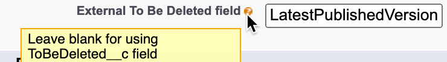
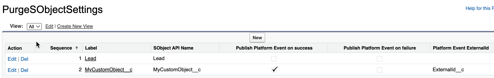
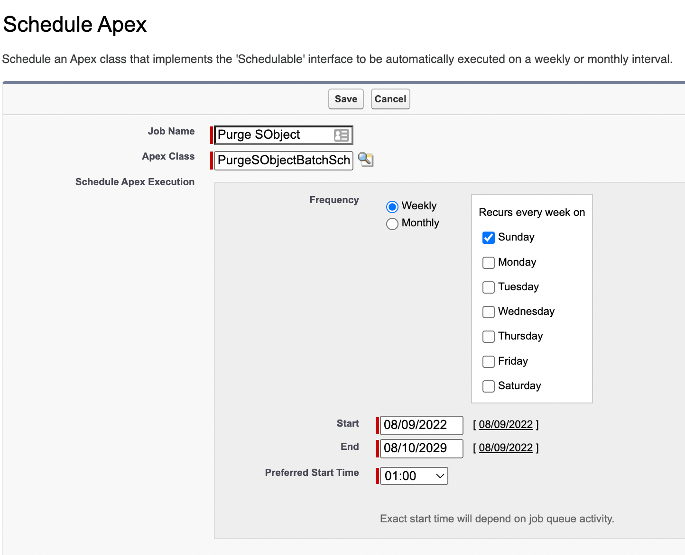

# SObject Purge Framework

This framework deletes records on a schedule. Admins configure which SObjects to purge, which records to delete, and in which order, with custom metadata records instead of code.

## Disclaimer

SObject Purge Framework is not an official Salesforce product. It has not been officially tested or documented by Salesforce.

## How it works

1. The scheduled job `PurgeSObjectBatchSchedulable` starts the `PurgeSObjectBatch` batch for the setting with the lowest `Sequence__c`. If a purge is still running, it skips this run.
2. The batch queries the records to delete for that SObject, and deletes them in chunks of `BatchSize__c` records (200 by default). A record that can't be deleted doesn't stop the others.
3. When the batch finishes, it starts a new batch for the next sequence, until the last setting.
4. If the query of a setting fails (unknown object or field, invalid WHERE clause), that SObject is skipped and the purge continues with the next sequence.
5. If there were errors, the user who runs the purge receives a summary email for that SObject.

## Configure the purge

The configuration has two parts:

- The delete logic: which records of an SObject must be deleted.
- One `PurgeSObjectSetting__mdt` custom metadata record per SObject to purge.

### Delete logic

Choose one of these options for each SObject:

| Option | How to configure it | Used when |
| --- | --- | --- |
| `ToBeDeleted__c` field (default) | Create a Boolean formula field named `ToBeDeleted__c` on the SObject. If the criteria are too complex for a formula, create a checkbox field and set it with a flow or an Apex trigger. | `WhereClauseToBeDeleted__c` and `ExternalToBeDeletedField__c` are empty |
| Custom WHERE clause | Enter a SOQL WHERE clause, without the `WHERE` keyword, in `WhereClauseToBeDeleted__c`. For example: `CreatedDate < LAST_N_DAYS:365`. | `WhereClauseToBeDeleted__c` is set |
| Field on a related object | Enter a Boolean field of a related object, through its relationship, in `ExternalToBeDeletedField__c`. For example: `LatestPublishedVersion.ToBeDeleted__c` to delete `ContentDocument` records based on a field of their `ContentVersion`. | `ExternalToBeDeletedField__c` is set |

The `PreventMultipleDeletionLogical` validation rule prevents setting both `WhereClauseToBeDeleted__c` and `ExternalToBeDeletedField__c`.

#### Objects that can't have custom fields

Some SObjects, such as `ContentDocument`, can't have custom fields. Use a field of a related object instead. For example, create `ToBeDeleted__c` on `ContentVersion`, and enter `LatestPublishedVersion.ToBeDeleted__c` in the `ExternalToBeDeletedField__c` of the `ContentDocument` setting.

[](./screenshots/externalToBeDeleted.png)

#### Performance on large objects

The batch selects the records to delete with one query. On a large object, a query that isn't [selective](https://help.salesforce.com/s/articleView?id=000385218&type=1) scans the whole table and can time out.

- Formula fields aren't indexed. Salesforce Support can add a custom index to some deterministic formula fields, but never to cross-object formulas such as `LatestPublishedVersion.ToBeDeleted__c`. A `ToBeDeleted__c` formula or an `ExternalToBeDeletedField__c` works well on small objects, but can be slow on large ones.
- On large objects, prefer a `WhereClauseToBeDeleted__c` on indexed fields, such as `CreatedDate < LAST_N_DAYS:365` or `LastModifiedDate < LAST_N_YEARS:2`. You can check a query with the Query Plan tool of the Developer Console.

### Custom metadata records

Create one `PurgeSObjectSetting__mdt` record per SObject to purge (Setup > Custom Metadata Types > PurgeSObjectSetting > Manage Records).

| Field | Required | Description |
| --- | --- | --- |
| `SObjectApiName__c` | Yes | API name of the SObject to purge. Each SObject can have only one setting. |
| `Sequence__c` | Yes | Order in which the SObjects are purged, from the lowest to the highest. Each setting needs a different number, from -99 to 99. Purge child objects before their parent, for example `OpportunityLineItem` before `Opportunity`. |
| `WhereClauseToBeDeleted__c` | No | SOQL WHERE clause that selects the records to delete. See [Delete logic](#delete-logic). |
| `ExternalToBeDeletedField__c` | No | Boolean field of a related object that selects the records to delete. See [Delete logic](#delete-logic). |
| `BatchSize__c` | No | Number of records deleted per chunk, from 1 to 2000. 200 when empty. Use a lower value for objects with cascade deletes or heavy triggers. |
| `PublishPlatformEventOk__c` | No | Publish a platform event for the deleted records. |
| `PublishPlatformEventKo__c` | No | Publish a platform event for the records that couldn't be deleted, and for a setting whose query fails. |
| `PlatformEventExternalId__c` | No | API name of a field of the purged SObject, sent as `ExternalId__c` in the platform events. |
| `PublishPlatformEventPerChunk__c` | No | Publish one platform event per chunk of records instead of one per record. See [Platform events](#platform-events). |

[](./screenshots/settings.png)

The repository contains a sample setting, `PurgeSObjectSetting.Lead`, with sequence 1. It deletes the leads whose last name is `TO-BE-DELETED`, and the test classes use it. Before deploying it, check that:

- No other setting of your org uses sequence 1, otherwise the deployment fails.
- Deleting leads with that last name is acceptable in your org.

## Run the purge

### Schedule the purge

In Setup, go to Apex Classes, click **Schedule Apex**, and select the `PurgeSObjectBatchSchedulable` class.

[](./screenshots/schedule.png)

Or schedule it with Anonymous Apex:

```apex
//run the purge every day at 1 AM
System.schedule('Purge SObjects', '0 0 1 * * ?', new PurgeSObjectBatchSchedulable());
```

To run a purge once, now:

```apex
new PurgeSObjectBatchSchedulable().execute(null);
```

### Running user

The purge runs as the user who scheduled it, or who started it.

- The batch runs `with sharing`: it only deletes the records this user can see. Records the user can see but not delete are counted as failures in the summary email.
- The user needs the Delete permission on every purged SObject. Without it, the batch deletes nothing for that SObject, and doesn't report it yet.

Use a dedicated admin or integration user with the Modify All permission on the purged SObjects.

### Deleted records

Deleted records go to the Recycle Bin. They stay there for 15 days and can be restored during that time. The framework doesn't empty the Recycle Bin.

### Stop a purge

- To stop the future runs, delete the scheduled job in Setup > Scheduled Jobs.
- To stop the current run, abort the `PurgeSObjectBatch` job in Setup > Apex Jobs. If the job of the next sequence is already queued, abort it too.

## Monitoring

Each SObject is purged by its own `PurgeSObjectBatch` job, listed in Setup > Apex Jobs.

### Summary email

When the purge of an SObject has errors, the running user receives an email with:

- The number of records deleted and not deleted.
- The number of chunks that failed with an unhandled error, and the first error.
- The errors of the run: a query that failed, or a next sequence that couldn't be started.
- Up to 10 distinct deletion errors.
- The configuration used: SObject, sequence, WHERE clause and batch size.

No email is sent when there is no error. The org email deliverability must allow Apex emails (Setup > Deliverability > Access level: All email). Sandboxes are often set to System email only: the email is then skipped, and the error is written to the debug log.

### Unhandled errors

`PurgeSObjectBatch` implements `Database.RaisesPlatformEvents`: an unhandled exception, including governor limit errors, publishes a standard `BatchApexErrorEvent`. External monitoring tools can subscribe to the `/event/BatchApexErrorEvent` channel.

- In a chunk, the deletions of that chunk are rolled back, the other chunks continue, and the summary email counts the failed chunk.
- In the start or the end of a job, the errors that Apex can catch are handled by the batch, which moves on to the next sequence. Errors that can't be caught, such as governor limit errors, stop the purge of the following sequences until the next scheduled run.

## Platform events

When `PublishPlatformEventOk__c` or `PublishPlatformEventKo__c` is checked, the batch publishes `PurgeSObjectBatch__e` events. They are published after the deletion is committed, so no event is sent for a deletion that is rolled back.

By default, one event is published per record. On large purges, this can use up the org's [platform event allocations](https://developer.salesforce.com/docs/atlas.en-us.platform_events.meta/platform_events/platform_event_limits.htm). You can either:

- Check `PublishPlatformEventPerChunk__c`: each chunk of `BatchSize__c` records publishes one event for the deleted records and one for the failed ones, with the records listed in `Records__c`. If the list is longer than the field, it is split between several events.
- Use [Change Data Capture](https://developer.salesforce.com/docs/atlas.en-us.change_data_capture.meta/change_data_capture/cdc_intro.htm) on the purged SObject, if the external system only needs the IDs of the deleted records. Change events don't contain the external id.

| Field | One event per record | One event per chunk |
| --- | --- | --- |
| `Success__c` | `true` if the record was deleted | `true` for the deleted records, `false` for the failed ones |
| `SObject__c` | API name of the purged SObject | API name of the purged SObject |
| `Id__c` | Record id | Empty |
| `ExternalId__c` | Value of the `PlatformEventExternalId__c` field | Empty |
| `Message__c` | Deletion errors, one per line | Empty |
| `Records__c` | Empty | JSON list of the records: `id`, `externalId` when set, and `message` for the failed records |

If the query of a setting fails (unknown object or field, invalid WHERE clause) and `PublishPlatformEventKo__c` is checked, one event is published with `Success__c` set to `false`, the error in `Message__c`, and an empty `Id__c`.

Platform event example (one event per record):

``` json
{
  "data": {
    "schema": "PYnPMKjl73Qx3gYURNrang",
    "payload": {
      "CreatedById": "0057a00000CsmbuAAB",
      "Success__c": true,
      "Message__c": null,
      "CreatedDate": "2022-10-14T07:13:03.051Z",
      "SObject__c": "Account",
      "ExternalId__c": "37",
      "Id__c": "0017a00002556lhAAA"
    },
    "event": {
      "EventUuid": "3e74df29-9a31-4463-8639-f460e5dd9cff",
      "replayId": 2682310,
      "EventApiName": "PurgeSObjectBatch__e"
    }
  },
  "channel": "/event/PurgeSObjectBatch__e"
}
```

Platform event payload example (one event per chunk):

``` json
{
  "Success__c": true,
  "SObject__c": "Account",
  "Id__c": null,
  "ExternalId__c": null,
  "Message__c": null,
  "Records__c": "[{\"id\":\"0017a00002556lhAAA\",\"externalId\":\"37\"},{\"id\":\"0017a00002556liAAA\",\"externalId\":\"38\"}]"
}
```

## Tests

The framework contains two test classes, `PurgeSObjectBatch_Test` and `PurgeSObjectBatchSchedulable_Test`.

- `PurgeSObjectBatch_Test` uses the sample Lead setting: it must be deployed and have the lowest sequence of the org. Otherwise, adapt the test to one of your settings.
- The tests insert two leads, so duplicate or validation rules on Lead can make them fail.
- The tests set the platform event options themselves, so the code coverage doesn't depend on your settings.

## Deploy to Salesforce

Check out the repository and deploy it with the Salesforce CLI:

```sh
sf project deploy start --source-dir force-app --target-org <your-org-alias>
```

To deploy without the sample Lead setting, delete `force-app/main/default/customMetadata/PurgeSObjectSetting.Lead.md-meta.xml` first, and adapt the tests.

Run the test classes in your org:

```sh
sf apex run test --class-names PurgeSObjectBatch_Test --class-names PurgeSObjectBatchSchedulable_Test --result-format human --wait 10 --target-org <your-org-alias>
```

Or use the GitHub Salesforce Deploy Tool:

[](https://githubsfdeploy.herokuapp.com/?owner=tprouvot&repo=purge-sobject&ref=main)
